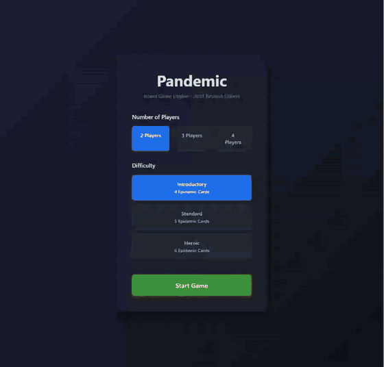
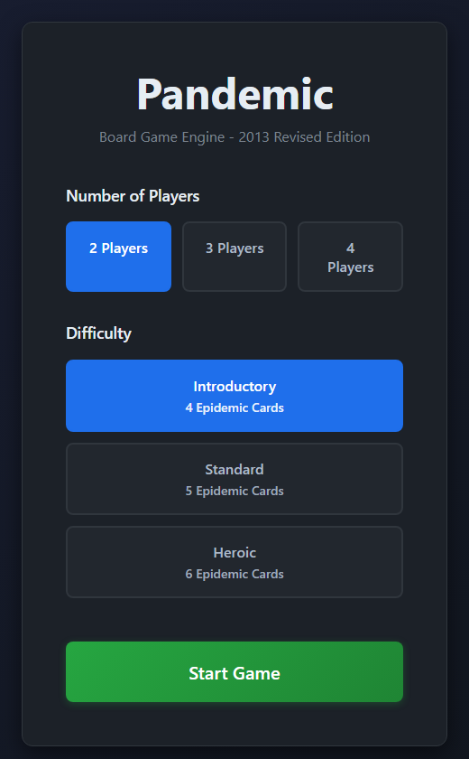
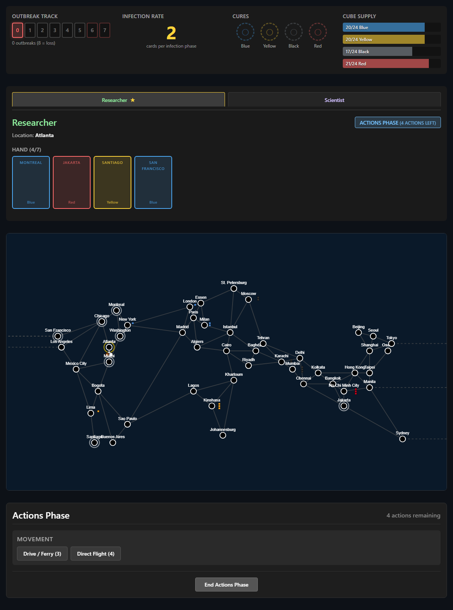
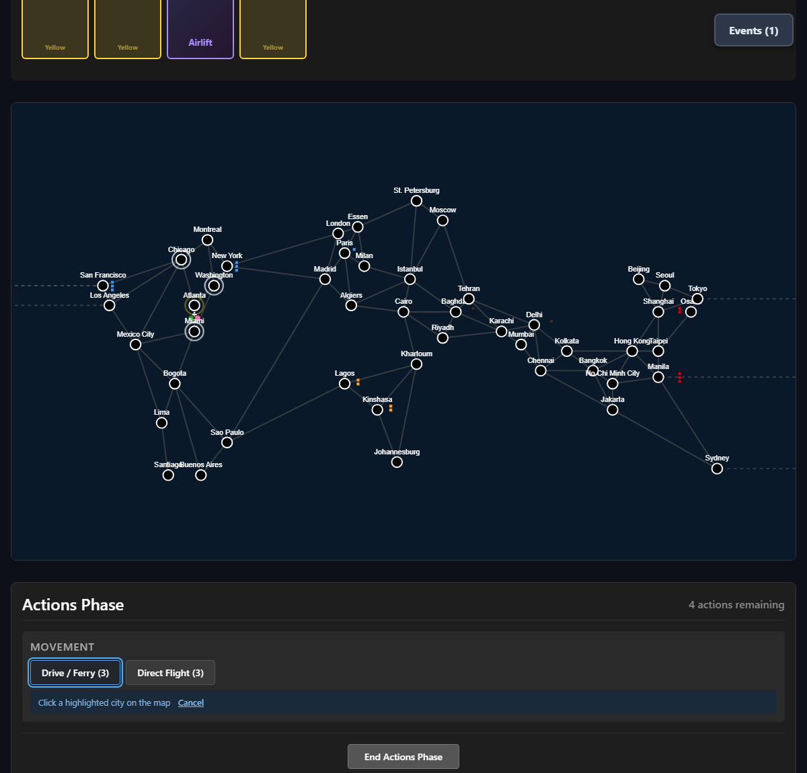
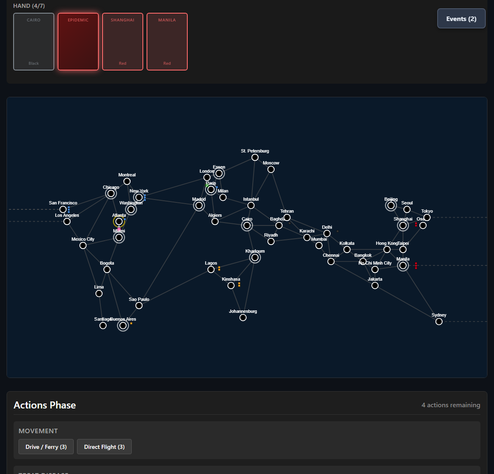

<div align="center">

# PandemicAI

### 48 cities · 4 diseases · 7 roles · one very bad week



*A complete, rules-accurate Pandemic engine in TypeScript, with a playable web UI and bots that argue with themselves about whether to treat Hong Kong.*

[](#tech-stack)
[](#the-web-ui)
[](#development)
[](LICENSE)

</div>

---

## What is this?

[Pandemic](https://en.wikipedia.org/wiki/Pandemic_(board_game)) is the cooperative board game where you and your friends race around the world to cure four diseases before they cure you. It's a game about careful planning, shared hands of cards, and the creeping realisation that you drew the third epidemic card on turn six.

This project is the whole game, implemented as a pure TypeScript engine (the 2013 Revised Edition rules), plus:

- a **written reference** for every rule, card, role and city, so the engine and any AI have something to be right *about*,
- a **web UI** for hot-seat play on an SVG world map,
- **AI bots** that can play complete games on their own, which is handy for solo play, stress-testing the engine and finding out whether the Quarantine Specialist is secretly overpowered.

<p align="center">
  
  
</p>

---

## The web UI

The browser interface is a React 19 + Vite app in [`web/`](web/) that drives the engine directly (no server, no backend, no accounts).

- **Setup screen.** Pick 2 to 4 players and Introductory, Standard or Heroic difficulty (4, 5 or 6 epidemic cards).
- **SVG world map.** All 48 cities, connections (with dashed Pacific crossings), disease cubes, research stations and role-coloured pawns.
- **Click to act.** Choose an action such as Drive / Ferry, then click one of the highlighted cities on the map.
- **Status at a glance.** Outbreak track, infection rate, cure status and cube supply stay on screen. The current phase is always spelled out.
- **Hot-seat play.** Pass the laptop round, with a hand panel per player and event cards playable at any time.
- **Dramatic moments.** Epidemics, outbreaks and discard decisions all get a proper dialog, because they deserve one.

<p align="center">
  
  
</p>

```bash
cd web
npm install
npm run dev      # http://localhost:5173
npm run build    # type-check + production build
```

---

## The engine

Everything lives in [`src/`](src/) as plain functions over a game-state object. There's no UI and no I/O in there, so it runs the same in a browser, a test or a terminal.

| Module | Responsibility |
| --- | --- |
| `board.ts` | The 48-city graph, colours and adjacency |
| `game.ts` | Game creation, setup, dealing, win and loss checks |
| `actions.ts` | Every player action: move, treat, build, share, cure, role abilities |
| `infection.ts` | Epidemics, infection draws, intensify, outbreaks and chain reactions |
| `events.ts` | The five event cards |
| `orchestrator.ts` | Turn and phase flow, so a UI only has to ask "what can I do now?" |
| `bot.ts` | `RandomBot`, `HeuristicBot` and `PriorityBot` |
| `serialization.ts` | Save, load and replay of full games |

### The bots

Anything that implements the small `Bot` interface can sit at the table:

- **RandomBot** picks any legal action. It's useless at winning and brilliant at finding bugs.
- **HeuristicBot** scores every legal action with weighted factors (and can explain its choice, e.g. *"Moving to Hong Kong (score: 7.5)"*).
- **PriorityBot** follows a rule-based priority list: treat a city on 3 cubes, discover a cure when it can, head for a research station with a full hand, share knowledge, and otherwise walk towards the worst outbreak. It will play One Quiet Night when the infection rate gets scary.

---

## Reference documentation

The real board game, written down as markdown so the engine has a source of truth:

- [Game Overview](pandemic-overview.md): core rules and objectives
- [Board](pandemic-board.md): the city network and regions
- [Cards](pandemic-cards.md): player and epidemic cards
- [Roles](pandemic-roles.md): all 7 character abilities
- [Rules](pandemic-rules.md): turn structure and edge cases

---

## Development

```bash
npm install
npm run build      # compile TypeScript
npm run test       # Vitest in watch mode
npm run test:run   # run the whole suite once
npm run check      # typecheck, lint, tests and format check
```

## Tech stack

- TypeScript (strict), no runtime dependencies in the engine
- Vitest, with over a thousand tests across the engine and the UI
- React 19 and Vite for the web UI
- ESLint and Prettier

---

## A short history

The game was first published in 2008 by Matt Leacock, and it has been teaching groups of friends the joy of collective panic ever since.

This repo's story is a lot shorter. It started on **10 February 2026** with the reference docs, and then an autonomous "Ralph Wiggum" loop took over: fresh-context AI iterations, each picking up the next task from [`IMPLEMENTATION_PLAN.md`](IMPLEMENTATION_PLAN.md), writing code and tests against the [specs](specs/), and committing. In about two days the engine, bots, serialisation and web UI were all in place. The [web UI plan](WEB_UI_PLAN.md) and [design notes](WEB_UI_DESIGN.md) show how that was steered.

---

## License

[MIT](LICENSE)
